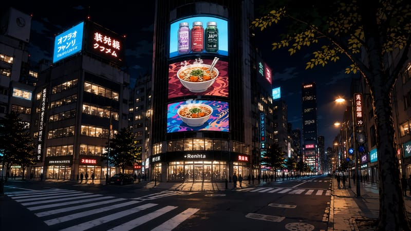

# Mundi

**Open worlds inside SillyTavern.** Mundi turns a SillyTavern group chat into a life you live: a city with a map and a clock, needs to look after, a job, bills, people with their own days, and the story the AI writes around what you do.

<p align="center"></p>

It is a SillyTavern **extension** (no server plugin). Everything is built on what SillyTavern already has: your character cards, personas, lorebooks and group chats. A save *is* a chat.

## What this fork adds

This is a fork of [tjalis/Mundi](https://github.com/tjalis/Mundi) with features of its own on top. Its version is **0.3.4**, built on Mundi 0.2.1 ([what changed](CHANGELOG.md)). Your existing Mundi saves open as they are, upgraded once with a backup kept in the save. It adds:

### A new world: Tokyo

<p align="center"></p>

Tokyo today, in anime style: eight districts (Shibuya, Shinjuku, Shimokita and Kōenji, Akihabara, Asakusa and Ueno, Marunouchi and Ginza, Odaiba, Roppongi) and two getaways (Yokohama and Hakone), with 89 places and 30 people who live there.

- **A city you get around by train.** Trips between districts take the train's time for the distance, there is a last train and a taxi after it, and each district has its own illustrated map, by day and by night.
- **Its own pictures.** Every place has a background for morning, afternoon and night, and a rainy one; snow, cherry blossom and autumn leaves where they belong. All 30 people have a portrait and 28 expressions.
- **Its own sounds.** Every place plays recordings made in Tokyo and around (the crowds, izakaya, stations, a konbini, the Shibuya crossing, cicadas in summer, a temple bell), following the hour and how busy it is.
- **Tokyo's year.** 31 festivals and events (cherry blossoms, Golden Week, Sanja Matsuri, Tanabata, the Sumida fireworks, Bon Odori, New Year's at the shrine…), typhoons, heat waves and the odd snow day.
- **Life there.** 45 jobs with their ranks (a Streamer among them: start from your room and choose your kind of stream), drinks with colleagues after work, senpai and kōhai, names that change as you get closer (from family name and -san to first names), praying and drawing omikuji at the shrines, and a language barrier if you start as a foreigner, which a language exchange with a friend helps with.
- **Seven starts** to begin from, and 71 small stories at the places.

| | | |
|---|---|---|
|  |  |  |

### Relationships that feel alive

People in your world have feelings of their own, for you and for each other, and act on them. **[Relationships in this fork](docs/relationships.md)** describes it all from a player's point of view.

- **Feelings go both ways.** Everyone feels their own way about everyone else, and people can come to dislike or even hate you. A crush can still outweigh dislike, so enemies to lovers is possible.
- **Friendship and romance are separate.** A best friend can stay just a friend; a stranger can flirt with you on the first night. Romance fades when you stop seeing each other, partners can leave you, and something casual is possible too. Exes are remembered as exes.
- **Scenes count.** Each scene is judged when it ends: kindness, flirting, a fight or an insult all change how people feel, right away. Swiping or editing replies no longer stacks changes.
- **Who people are.** Everyone can have a gender, an attraction (who they can fall for), a way of being about intimacy (from free spirit to devoted) and an exclusive or open relationship style. Your AI can suggest them from the cards.
- **A dating app that takes its time.** On Spark you choose which genders you see; a like is answered days later, or never, and a match takes something in common.
- **People take the initiative.** They open up, confess their feelings, ask you out, text you, warn you before a breakup, hold grudges until you apologize, get jealous, and talk about you to their friends. How often is up to you.
- **The world's people live their own lives.** They make friends, fall out, fall for each other, date, marry and break up, from their own feelings.
- **Family is family, feelings are feelings.** Family ties (parents, children, siblings and half-siblings, grandparents, aunts and uncles, cousins, step-family, in-laws, godparents, guardians) are kept apart from how people feel; everything else, from best friends to exes, is set as feelings: in the new game, the World creator and the People tab, without needing the Advanced settings.

### Living and working

- **Jobs with a working week.** Each job has its shifts and days off, and you see them in the Calendar and the Jobs app. How well you work builds your performance, and a promotion says what it still needs ("Logic 2 or Drawing 2"). A career takes about a game year to reach the top. Sick days, vacations and lateness follow work rules you can ease (Realistic, Reduced, Relaxed), and you can set the career speed.
- **The world's people work too.** They keep their own shifts, with days off spread across the team and vacations, so you find them at work when they're on. The world's own people keep the jobs and homes the world gave them.
- **A job is something you earn.** An interview is a long shot with nothing that helps (about 30%); what you're good at, the traits a job likes and its course make the difference, a job beyond your reach won't see you, and asking again every day doesn't win it. With adult content on, Tokyo's women's night jobs take anyone else only with an introduction or a top skill. [More on it](docs/improvements.md#jobs-and-rolls).
- **Skills.** Hobbies became skills that level up, the world's own skills included. Things you do and courses can train them.
- **Who you are matters.** Your strengths start your skills ("Good cook · Cooking 3"); your personality and interests each do something small, help with the jobs that like them and are told to the AI; habits have names of their own and make their skill train faster. No job is closed to your personality, and every roll gets the same bonus from your skill.
- **Courses that take weeks.** Classes on a schedule or five days a week, a few you can miss (more cost make-up classes), two courses at once, long programs paid by the season, help with the fee, jobs you can start while you study for them, and a word from your boss when your next rank needs a course. Tokyo has 17, and two more with adult content on. [More on it](docs/improvements.md#who-you-are-and-courses-that-take-weeks).
- **University.** Study for a degree at Tokyo's Hijiri University, the way The Sims does it: terms of a season, a few modules each term, classes on campus, coursework, grades from A to F and a GPA, a scholarship you can lose, probation, and graduating (with distinction, a rank up in related jobs). While you study, work is part-time and only student homes are open; some jobs want a degree. The University student start begins enrolled, and a Campus app follows it all. [More on it](docs/improvements.md#university).
- **Training together.** A friend who is good at what you're not can teach you, you can teach what you know, or you trade: a Japanese friend teaching you Japanese while you help with their English. It's agreed in conversation (suggest it in your own words, or accept when someone offers), then sessions of an hour twice a week bring you up to a level below your teacher and bring you closer. It replaces apprentices. [More on it](docs/improvements.md#training-together).
- **Life goals with perks.** Follow one life goal at a time (get rich, find love, make it in Tokyo…) through its steps; finishing it gives a perk that changes the game's numbers for good, and steps earn life points for a small shop (a lucky day, a nudge, an invitation, Tokyo's shrine charms). Tokyo has 25 goals of its own (six of them adult), and the World creator lets you write your world's. [More on it](docs/improvements.md#life-goals-and-life-points).
- **Tokyo's adult progression.** With adult content on, Tokyo's love life and night world have something to play: a Sensuality skill, private moments that go better or worse, learning what someone likes, a Desire need and a drive for everyone, the risk of being caught, careers with a track for each gender (AV and the esthe), two courses, traits, goals and shop items. None of it exists with the switch off. [More on it](docs/improvements.md#tokyos-adult-progression).
- **Gifts that mean something.** Buy them where they're sold. A romantic gift warms a crush or a partner; an intimate one only lands with someone drawn to you, and is loved when it fits their intimate profile.
- **Couples go out.** Couples among the world's people go on dates a couple of evenings a week, at places they both like.
- **A new game your way.** Choose the world's own people one by one, and begin from a start: who you are, your home, money and job, and who you know already. You can write your own start with a premise the AI is told, or change one of the world's starts for that game (its money, home, whom you know and your skills), and keep it for later. One switch decides adult content, and with it on, people's intimate profiles can be seen and changed.
- **The AI knows the scene better.** In a crowded place it hears once what the people there share (why they're here, where they stand with you), and results written for you ("You nail the chorus") reach it as what you were told. The world's lorebook stays small in every request.

### Other improvements

More on each in **[Other improvements in this fork](docs/improvements.md)**.

- **A color for each speaker's dialogue.** The quotes in each line, and the speaker's name, take that person's color, chosen by your AI to fit the characters and kept readable (Chat look, ☰ menu).
- **Outfits from the game.** With adult content on, the people in a private moment wear their "naked" outfit and dress again after; a world's people can bring outfits of their own. With it off, adult actions stay hidden everywhere.
- **A World creator that edits everything.** Every field of the built-in worlds, Tokyo included, can be changed in the World creator: lore, rolls and outcomes, street stories, starts, keepsakes, people's appointments and storylines, weather, trains, places' hours and pictures. [More on it](docs/improvements.md#the-world-creator-and-the-new-game).
- **Your own additions to a built-in world.** A file in SillyTavern's user files (`mundi-overlay-<world id>.json`) adds places, people, actions, lore and pictures to a built-in world when it loads, without touching the world itself (the format is at the top of `src/core/overlay.ts`).
- **Easier to find your way.** The map's Find button lists every place matching a name, with its district and the trip there; each skill on the Profile says where to practise it and when; notices count down one at a time and stay in a Log (☰ menu); the cards that come to you show one at a time; the Jobs app sorts its openings; and the main menu tells you when Mundi has an update. [More on it](CHANGELOG.md#034--2026-11-12).
- **New pictures reach your cards.** When a world updates a character's expressions or outfits, cards made before get them too.
- **Pictures that follow the weather and the season,** expression sprites in any format, and everything in Portuguese and Spanish.

## What you can do

- **Live in a world.** A map of places, time that moves when you act, weather and seasons. Energy, hunger, thirst, mood and hygiene drop over time.
- **Talk.** A visual-novel scene with Say / Do / Story / See. Type `@` to pick who answers. The engine keeps the numbers (time, money, relationships); the AI writes the scene.
- **Relationships.** Friendship and romance bars with levels, approval, feelings that fade, dates, proposals, marriage, a baby. People keep their own routines: find them, or text them.
- **Work and money.** Job interviews (a d20 roll with your skills and the traits the job likes as bonus), shifts, promotions, quick gigs, courses that teach skills, weekly rent, water and power that get cut off if you don't pay (you can pay part of what you owe, and a bill cut off owes no more weeks). Easy / Normal / Hard.
- **A phone.** Messages, People, Jobs, Bank, Homes, Chirp (social), Spark (dating), Calendar, Journal, Shop, Goals, Profile and Help.
- **Households and "Play as".** Live with family or roommates, then switch to playing any of them.
- **A diary.** Each night the day is written as a short entry, so the story remembers what happened.
- **Make it yours.** Layouts (Visual novel, Classic, Cards), colors with transparency, presets that tint the HUD glass, a world creator for your own maps and rules.
- **Phones.** Upright and sideways layouts, with their own scale for the HUD.
- **A tour.** Stella shows you around in a practice world. No AI needed.
- **Home mode.** A more role-play focused way to play: one house, the characters you choose, no work or bills. Pick the rooms, draw a floor plan, go out and come back.
- **In your language.** The interface is in English, Português (Brasil) and Español (Settings → Interface → Language).

It comes with **Porto Alto**, a modern coastal state with five cities (Midtown, Palm Coast, Maple Heights, Pinecrest and Green Valley), **Tokyo** (this fork's), and **The Shared House** for Home mode. The medieval style (Valdoria) and the RPG mode are coming in a later update.

See [CHANGELOG.md](CHANGELOG.md) for what changed in each version.

## Screenshots (0.2)

| | | |
|---|---|---|
|  |  |  |
|  |  |  |
|  |  |  |

## Screenshots

| | |
|---|---|
|  |  |
|  |  |
|  |  |

On a phone:

<p align="center">
  
  
  
</p>

## Install

1. In SillyTavern, open **Extensions → Install extension**.
2. Paste `https://github.com/tjalis/Mundi` and install (or `https://github.com/rorikke/Mundi` for this fork; if you already have Mundi installed, remove it first).
3. Reload SillyTavern (Ctrl+F5). Open Mundi from the **Extensions menu** (the magic wand next to the chat box). The tour starts the first time you open it.

Works with SillyTavern 1.19 or newer. Any chat-completion or text-completion API works; a context of about 30k tokens is a good size.


## Building from source

The repository ships the compiled `dist/` and `style.css`, so you don't need to build to use it. To change the code:

```sh
npm i -g typescript
./build.sh        # src/*.ts → dist/, css/*.css → style.css
```

## Credits

- Sounds by [Kenney](https://kenney.nl) (CC0).
- Tokyo's place sounds: recordings from [Freesound](https://freesound.org) by markystar, manuke, jrussell_tm,
  Heigh-hoo, muse88, Intimana, RutgerMuller, csaszi, gazy, macdaddyno1, piego, BenParamoreAudio, 170026 and Kinoton
  (CC0), and by RadioGoldProductions, volivieri, LG, Echograin (CC BY 4.0) and Tomlija (CC BY 3.0); see
  [`worlds/tokyo/sound/CREDITS.md`](worlds/tokyo/sound/CREDITS.md) for each recording, its license and what was
  changed.
- Seraphina is SillyTavern's default character; her picture is bundled for the tour.

## License

[AGPL-3.0](LICENSE), the same license as SillyTavern.
