

<h1 align="center">Mundi</h1>

  <b>An open-world life sim for SillyTavern, set in the Tokyo of today.</b> 
  Get a job, find a place, fall for someone, build something that outlasts you. 
  The engine keeps the clock, the money and the feelings. Your AI writes the scenes.

  <a href="#install"><b>Install</b></a> ·
  <a href="#a-city-with-a-clock">The city</a> ·
  <a href="#people-with-lives-of-their-own">The people</a> ·
  <a href="#a-life-to-build">Your life</a> ·
  <a href="#the-long-game">The long game</a> ·
  <a href="#after-dark">After dark</a> ·
  <a href="#under-the-hood">Under the hood</a>

  <b>39</b> people · <b>122</b> places · <b>10</b> districts and getaways · <b>72</b> personal storylines ·
  <b>50</b> careers · <b>34</b> festivals · <b>166</b> things to buy · <b>~100</b> museum pieces 
  Counts include what the adult content switch adds.

  
  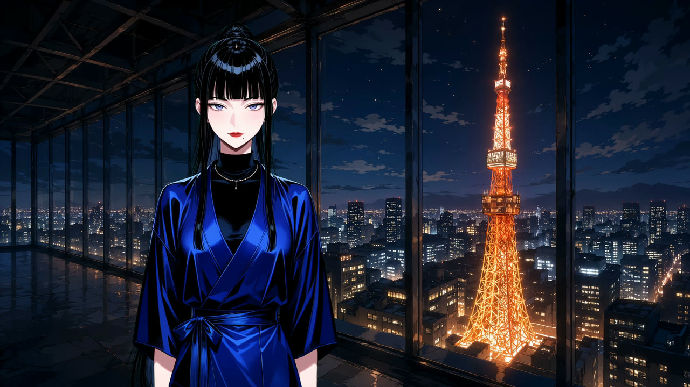
  
  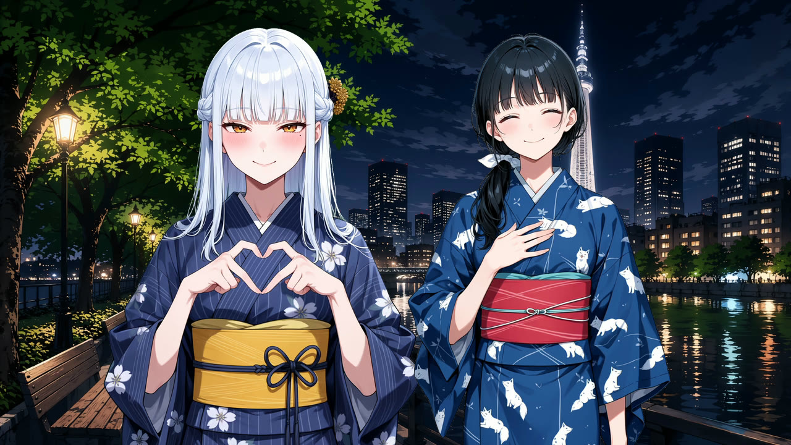

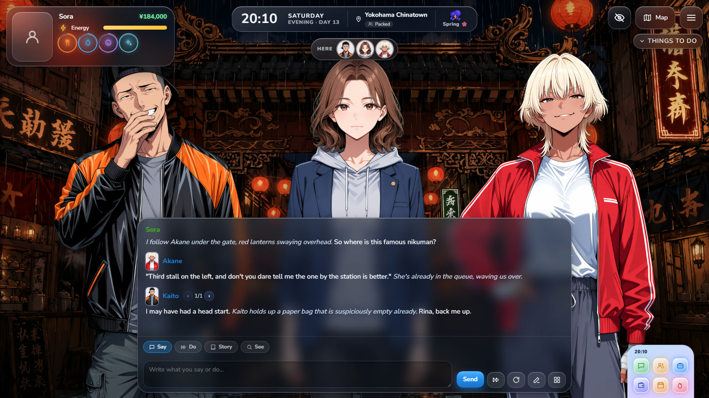

How it plays: you write what you say or do, your AI answers as the people in the scene, and the
engine keeps the clock, the money and the feelings around them.

## A city with a clock

Eight districts, from Shibuya and Shinjuku to Asakusa, Akihabara and Odaiba, plus Yokohama and Hakone for a day
away. You get around by train: trips take real time, and the last train really is the last one. Shops open and close,
people go to work and come home, and you get tired, hungry and behind on rent.

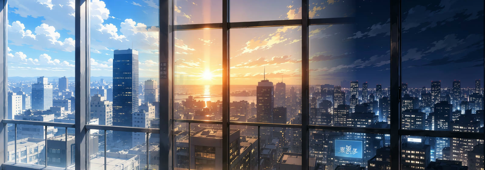

Every place is drawn for the morning, the afternoon and the night, and outdoors for the rain as well.

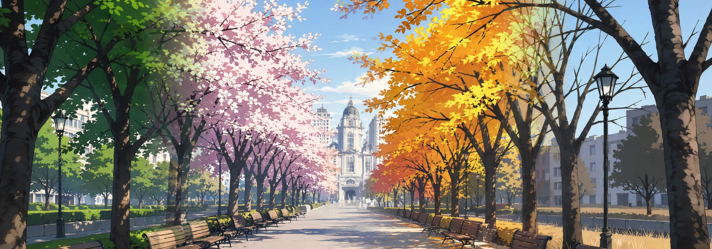

The year turns: cherry blossom, summer green, autumn leaves, bare branches and the odd snow day.
34 festivals and events, from Sanja Matsuri and the Sumida fireworks to the New Year's shrine visit.

Each district has its own illustrated map, by day and by night. Every place plays its own sounds
(station crowds, an izakaya, cicadas in summer, a temple bell), following the hour and how busy it is.

## People with lives of their own

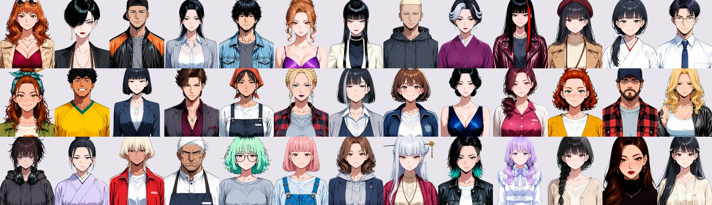

An art student working night shifts, a band that can't agree on its future, a ramen master and his daughter, a
shrine maiden, a photographer, a rival collector, a dealer with a camper van, a host, a section chief, an idol. Each
has a home, a job with shifts, friends, favorite places and a storyline that waits for you at its turning point.

28 expressions per person, each a pose of its own. The scene shows whichever fits the line.

- **Feelings go both ways.** Friendship and romance are separate bars. Kindness, flirting, a fight or an insult
  change how people feel once the engine has judged the scene.
- **They take the initiative.** People text you, ask you out, confess, hold grudges and get jealous. Among themselves
  they make friends, date, marry and break up.
- **Your cast, your choice.** Pick Tokyo's people one by one and bring in your own SillyTavern characters. Each one
  gets a home, a routine and a job.

What people wear follows the place and the story: swimwear at the beach and the pool, yukata at
the summer festivals, a gown for an opening night, and their own clothes at home.

  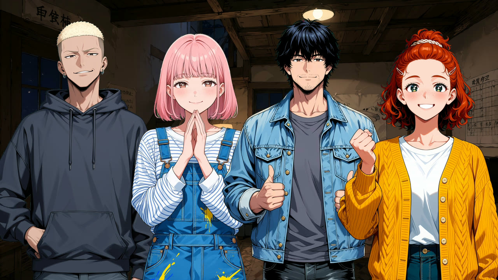
  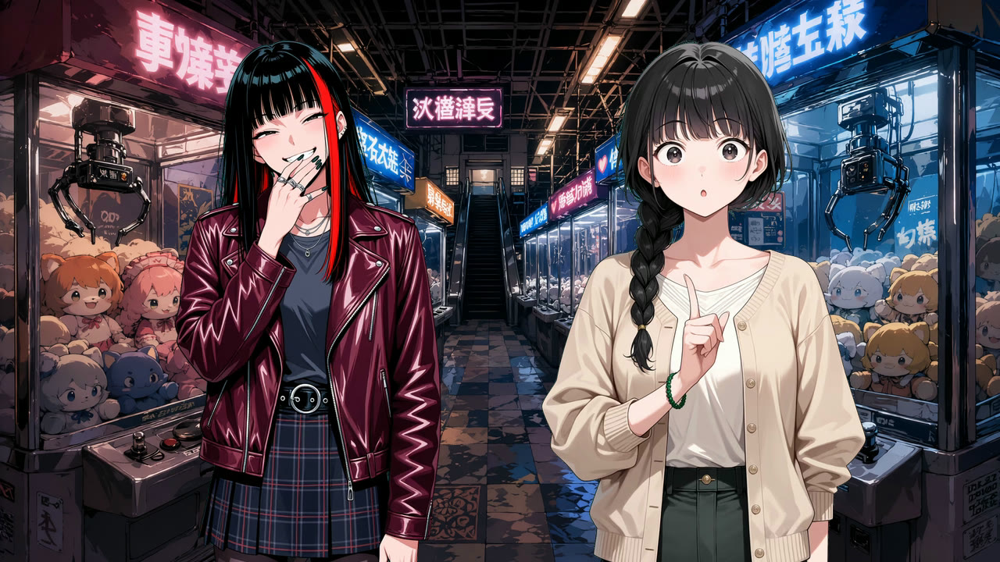

The Kōenji share house, where your housemates keep the house's rhythm, and Nanami and Linh at an
Akihabara arcade on their day off.

## A life to build

Pick one of seven starts (up from the countryside, a university student, new in Japan, down on your luck…) or write
your own, and go from there.

  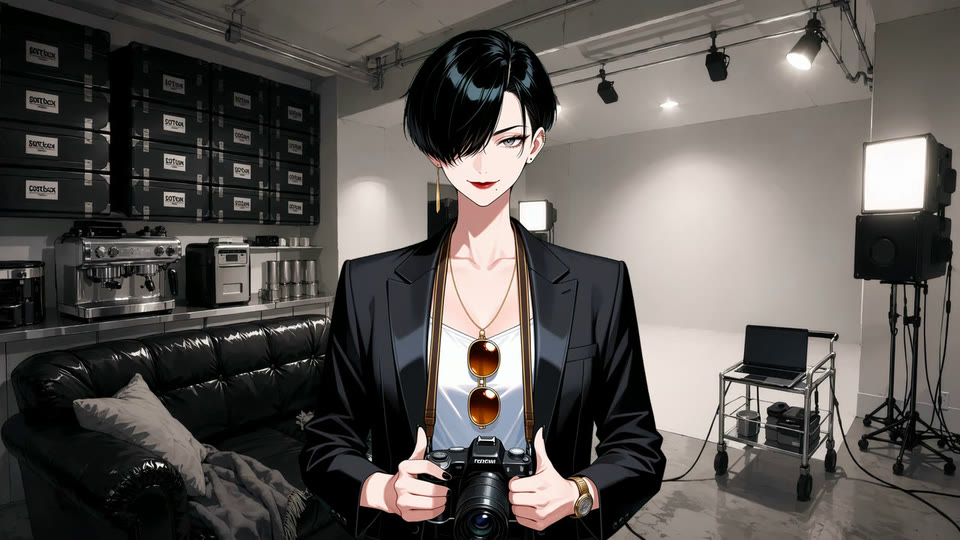
  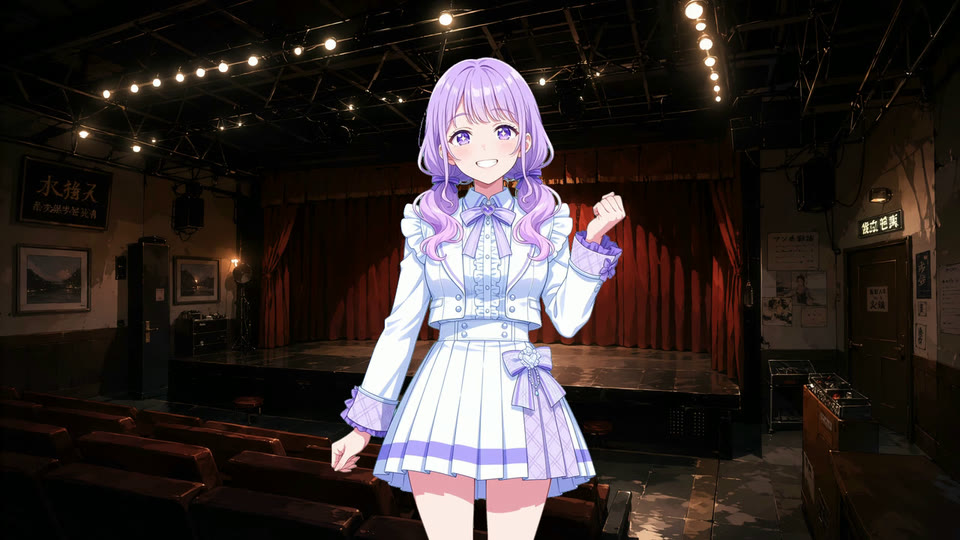
  
  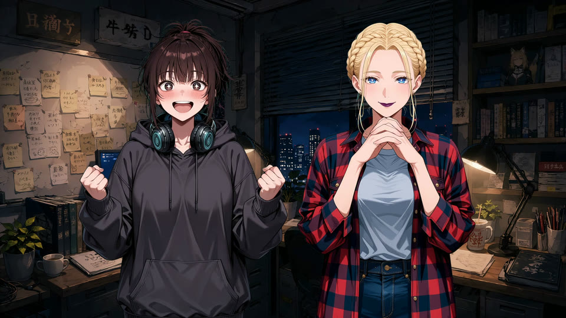
  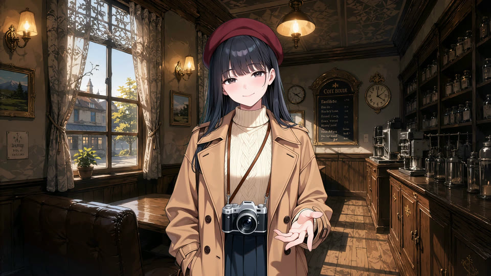
  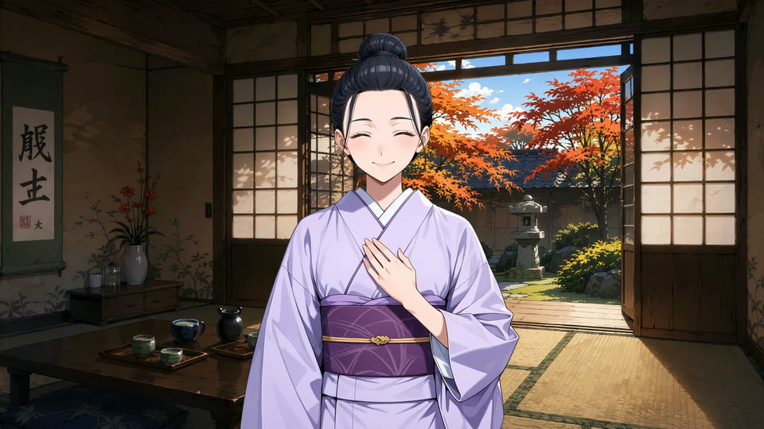

Six of 50 careers, each with its own people: the photographer at Studio MIZU, the idol at Stage
Starlight, the office at Asahina Trading, the game developers at Mochi Byte Games, the kissaten and the ryokan in Hakone.

| | |
|---|---|
| **Work** | 50 careers with ranks, shifts and days off. Interviews are earned with skills and the right traits. Ramen cook, nurse, animator, idol, rickshaw puller, streamer… |
| **Skills** | 16 skills that level up from practice, courses and the people around you. A friend can teach you, or you trade: your English for their Japanese. |
| **Study** | Courses on a timetable, or Hijiri University: terms, coursework, grades, a GPA and a scholarship you can lose. |
| **Goals** | 38 life goals, from *make it in Tokyo* to *find love*, each with a perk for good, and life points for a small rewards shop. A storyline that ended badly can even get a second chance. |

## The long game

Once rent stops being the worry, Tokyo has something to aim for.

Tokyo's 339 keepsakes, shop items, rewards, home fixtures and museum upgrades each have a picture, from
a ¥1,000 charm to a car that drives you home after the last train.

- **Run a business.** Take over an old kissaten or open your own café and grow it into a roastery. You can also run a
  division on the executive floor, or own a capsule hotel in Shinjuku and be a partner in a ryokan in Hakone.
- **Own your home.** Buy a flat or a villa, fit it out with a sauna, a grand piano or a hot-spring bath, and let the
  homes you don't live in.
- **Build a museum.** Collect art, antiques, insects and fish, join a university dig, outbid a rival at four auctions
  a year, and turn an old Yanaka storehouse into a private museum.

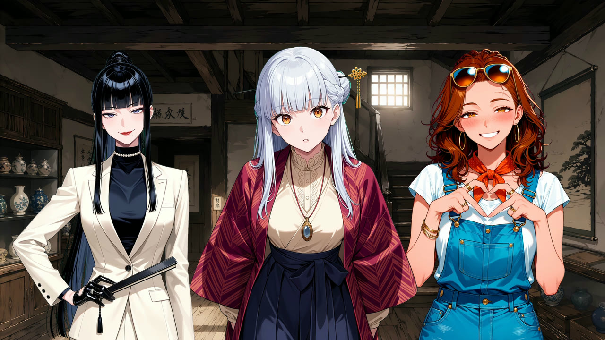

The museum has its own people: Tamaki the curator, Kaede the dealer and Ayame the rival, each
with storylines of their own.

## After dark

One switch, off by default. Leave it off and none of this is in your game. Turn it on and Tokyo's night life opens
up: more people, places, careers and storylines, private moments with their own rules, and a career in the adult
film industry.

  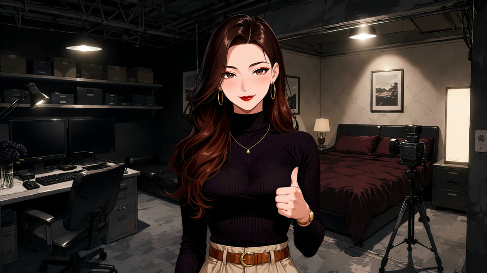
  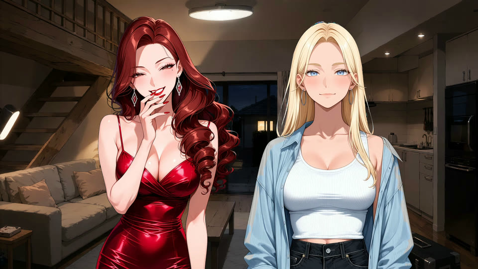
  
  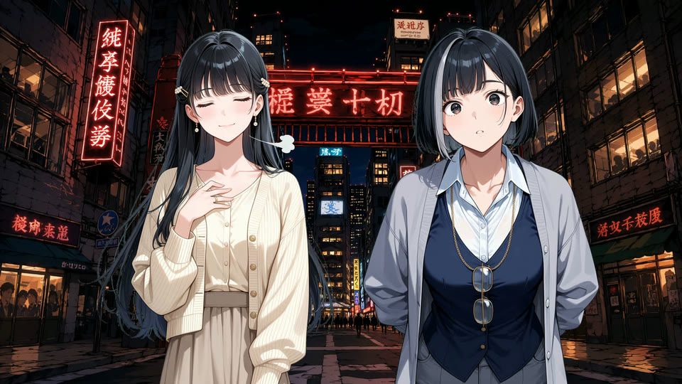
  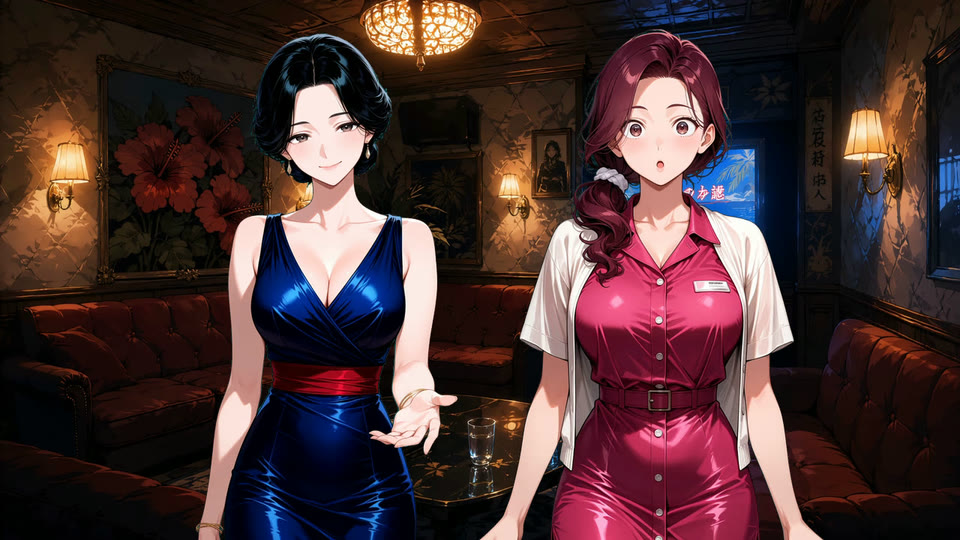
  

Naomi Reid-Kagami runs Kurobara Visual in Nakano: work title by title as a performer, become a
name director, or start a label of your own, and meet the fans at the industry's expo. Around it, Kabukichō, a hostess
club in Yokohama and Roppongi's clubs, each with people of their own.

## Under the hood

Mundi is a SillyTavern **extension**, with no server plugin. It is built from SillyTavern's own pieces: characters
are cards, you are a persona, the world's lore is a lorebook, and **a save is a group chat**.

- **The engine owns the numbers, the AI plays the scenes.** The AI is told the state of the world each turn. When
  the engine needs an answer (how did that scene go?), it asks a short follow-up question and reads the reply, so
  free text never sets money, time or feelings.
- **A visual-novel scene.** Say, Do, Story or See, `@` to choose who answers, a color for each speaker, and an eye to
  hide the interface and just look.
- **A phone** that unfolds to twice its width: Messages, People, Work (Jobs, Campus, Business), Lens, Money, Homes,
  a Calendar that can wait until it's time to go, Goals, Collection, and Spark, a dating app with real profiles.

  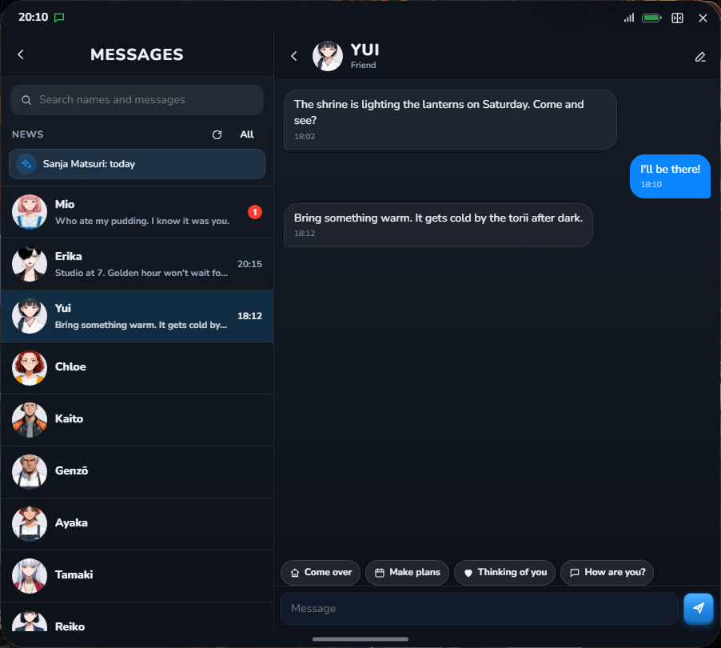
  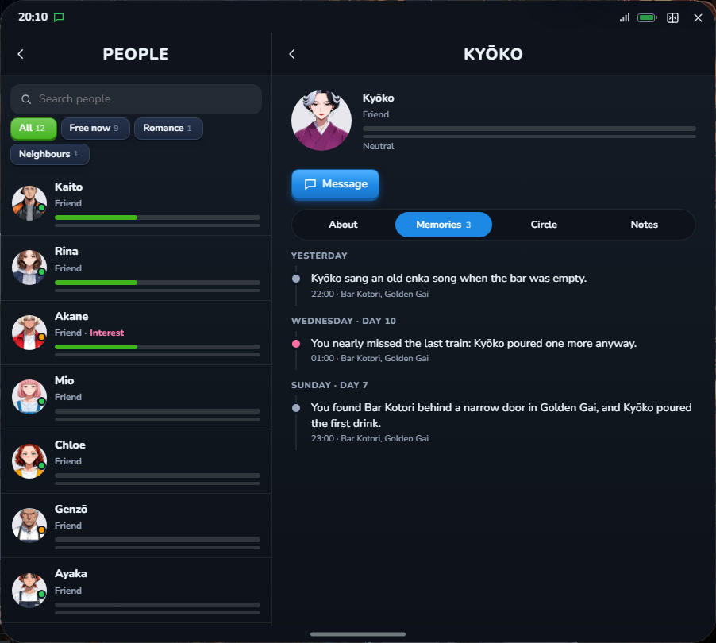
  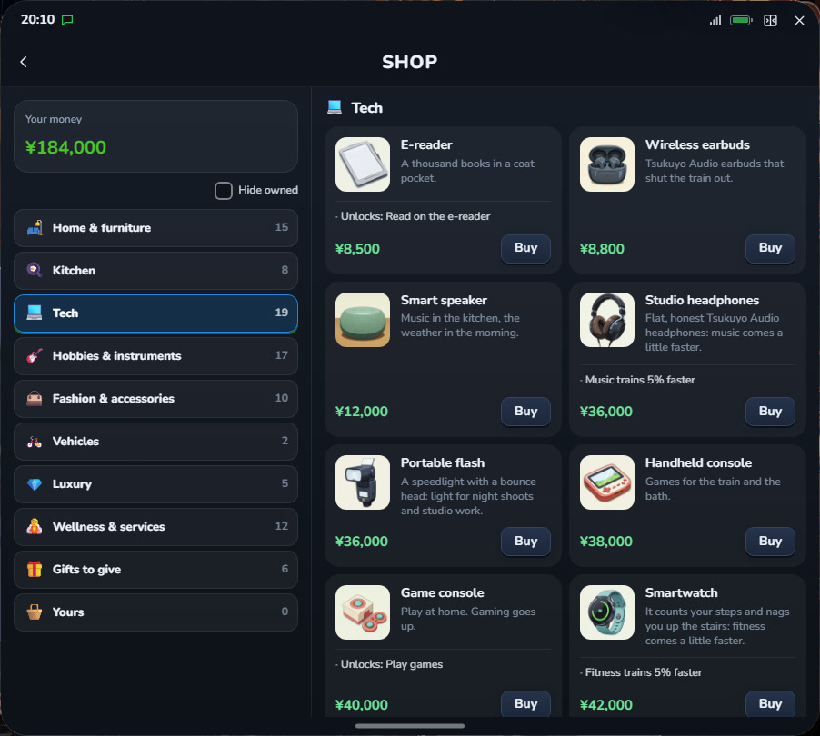
  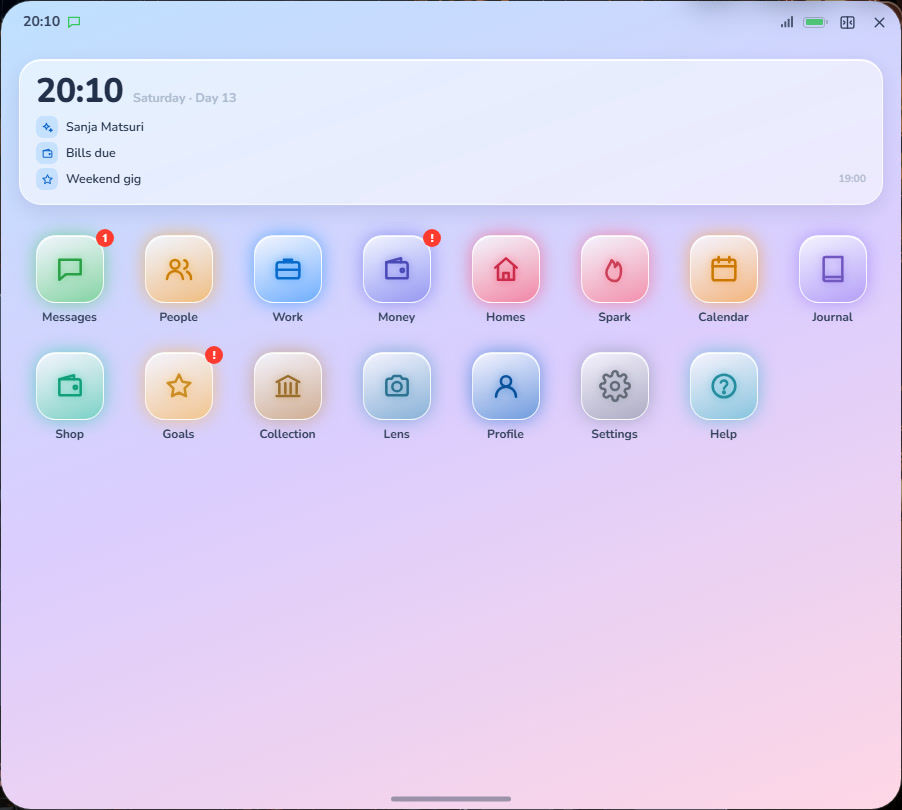

- **A diary.** Each night the day becomes a short entry, so the story remembers.
- **A World creator that edits everything,** Tokyo included. Overlay files add to a built-in world without touching
  it.
- **In English, Portuguese and Spanish.**

  
  

Beyond Tokyo: <b>Porto Alto</b>, a coastal state with five cities, and <b>The Shared House</b>
for Home mode (one house, the characters you choose, no work or bills).

## Install

1. In SillyTavern, open **Extensions → Install extension**.
2. Paste `https://github.com/rorikke/Mundi` and install.
3. Reload SillyTavern (Ctrl+F5) and open Mundi from the **Extensions menu** (the magic wand by the chat box). A short
   tour with Stella starts the first time, and needs no AI.

**Needs:** SillyTavern 1.19 or newer and any chat-completion or text-completion API. About 30k tokens of context is a
good size.

The repository ships the built `dist/` and `style.css`, so there's nothing to build. To work on the code, see
[`docs/dev/ARCHITECTURE.md`](docs/dev/ARCHITECTURE.md) and run `./build.sh` (needs TypeScript).

## Learn more

- **[The full guide](docs/improvements.md):** jobs and rolls, university, business, homes, storylines, the museum
  and the rest, system by system.
- **[Relationships](docs/relationships.md):** how feelings, romance, attraction and initiative work.
- **[What changed](CHANGELOG.md)** in each version, and **[what's next](docs/ROADMAP.md)**.

## Credits

- Built on the original [Mundi](https://github.com/tjalis/Mundi) engine by tjalis.
- Interface sounds by [Kenney](https://kenney.nl) (CC0).
- Tokyo's place sounds: recordings from [Freesound](https://freesound.org) by markystar, manuke, jrussell_tm,
  Heigh-hoo, muse88, Intimana, RutgerMuller, csaszi, gazy, macdaddyno1, piego, BenParamoreAudio, 170026 and Kinoton
  (CC0), and by RadioGoldProductions, volivieri, LG, Echograin (CC BY 4.0) and Tomlija (CC BY 3.0). See
  [`worlds/tokyo/sound/CREDITS.md`](worlds/tokyo/sound/CREDITS.md) for each recording, its license and what was
  changed.
- Seraphina is SillyTavern's default character; her picture is bundled for the tour.

## License

[AGPL-3.0](LICENSE), the same license as SillyTavern.
