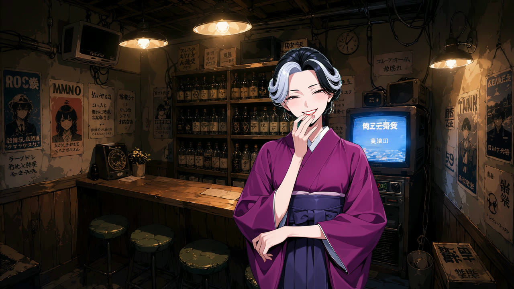

<h1 align="center">Mundi</h1>

  <b>An open-world life sim for SillyTavern, set in the Tokyo of today.</b> 
  Get a job, find a place, fall for someone, build something that outlasts you. 
  The engine keeps the clock, the money and the feelings. Your AI writes the scenes.

  <a href="#install">Install</a> ·
  <a href="#a-city-with-a-clock">The city</a> ·
  <a href="#people-with-lives-of-their-own">The people</a> ·
  <a href="#a-life-to-build">Your life</a> ·
  <a href="#the-long-game">The long game</a> ·
  <a href="#under-the-hood">Under the hood</a>

  <b>38</b> people · <b>120</b> places · <b>10</b> districts and getaways · <b>70</b> personal storylines ·
  <b>50</b> careers · <b>32</b> festivals · <b>166</b> things to buy · <b>~100</b> museum pieces 
  Counts include what the adult content switch adds.

  
  

## A city with a clock

Eight districts, from Shibuya and Shinjuku to Asakusa, Akihabara and Odaiba, plus Yokohama and Hakone for a day
away. Each district has its own illustrated map, by day and by night. You get between them by train: trips take the
real time for the distance, the last train really is the last, and after it there's a taxi.

Time moves when you act. Shops open and close, people go to work and come home, and you get tired, hungry and
behind on rent.

Places are drawn for the morning, the afternoon and the night, and outdoors for the rain as well.

The year turns too: cherry blossom, summer green, autumn leaves, bare branches and the odd snow day.

- **Tokyo's calendar.** 32 festivals and events, from Sanja Matsuri and the Sumida fireworks to Bon Odori and the
  New Year's shrine visit, plus typhoons and heat waves.
- **It sounds like Tokyo.** Places play field recordings (station crowds, an izakaya, a konbini door, cicadas in
  summer, a temple bell), following the hour and how busy it is.
- **Small rituals.** Pray and draw omikuji at the shrines, drink with colleagues after work, and watch names change
  as you get closer, from family name and -san to first names. Start as a foreigner and there's a language barrier
  to work through.

## People with lives of their own

An art student working night shifts, a band that can't agree on its future, a ramen master and his daughter, a
shrine maiden, an English teacher three years in, a host, a section chief, an idol. Each has a home, a job with
shifts, friends, favorite places and a full set of expressions.

28 expressions per person, each a pose of its own. The scene shows whichever fits the line.

- **Your cast, your choice.** Choose Tokyo's people one by one when you start a game. Leave out every man, or anyone
  else, and the world still works: jobs, storylines, businesses and the museum are all built to run with whoever
  you keep. Then bring in your own SillyTavern characters: each gets a home, a routine and a job in the city, and
  you say how they know you. Their cards stay as they are.
- **Feelings go both ways.** Everyone feels their own way about you and about each other. Friendship and romance
  are separate bars: a best friend can stay a friend, and a rival can still become something more.
- **Scenes count.** When a scene ends, the engine judges it. Kindness, flirting, a fight or an insult change how
  people feel. Swiping a reply doesn't stack the effect.
- **They take the initiative.** People text you, ask you out, confess, warn you before a breakup, hold grudges until
  you apologize, get jealous and talk about you to their friends.
- **They live without you.** The world's people make friends, fall out, date, marry and break up from their own
  feelings, and couples go on dates of their own.
- **Storylines that wait for you.** 33 people carry a story: a debt, an exam, a visa, a lease, someone leaving. It
  runs through the seasons, and at its turning point it waits for you. Help, wait for a better ending, or let it go.
- **Who people are.** Gender, attraction, intimacy style, exclusive or open: set per person, or let your AI suggest
  it from the card. Not everyone is drawn to everyone.
- **Dressed for the place.** At the pool, on the beach in summer or at a swimsuit hot spring, people change into
  their own swimwear, each as bold as they go in public. Tamaki wears her yukata to the summer festivals.
- **Under one roof.** The Kōenji share house has a room for each of you, a kitchen and a common room, and your
  housemates keep its rhythm: breakfast in the kitchen, the TV in the evening, a knock on your door. A close friend
  can come and stay for a few days.

  
  

## A life to build

Pick one of seven starts (up from the countryside, a university student, new in Japan, down on your luck…) or write
your own, and go from there.

| | |
|---|---|
| **Work** | 50 careers with ranks, shifts and days off. Interviews are earned with skills and the right traits, not by asking again tomorrow. Promotions say what they still need. One career is a streamer, starting from your room; another is a photographer, assisting at a studio until you go freelance. |
| **Skills** | 16 skills that level up from practice, courses and the people around you. A friend can teach you what they know, or you trade: your English for their Japanese. |
| **Study** | Courses that run for weeks on a timetable. Or Hijiri University: terms, modules, coursework, grades and a GPA, a scholarship you can lose, and graduation. |
| **Goals** | 38 life goals for Tokyo, from *make it in Tokyo* to *find love*. Finish one for a perk that changes the numbers for good; its steps earn points for a small rewards shop, shrine charms included. |

## The long game

Once rent stops being the worry, Tokyo has something to aim for.

- **Run a business.** Take over an old kissaten when its master retires, or lease a unit and name your own café,
  then grow it from a stand to a roastery. Climb past the top rank to the executive floor and run a division. Or
  own hotels: a capsule hotel in Shinjuku, and a ryokan in Hakone as a partner of the family that runs it.
- **Own your home.** Buy a flat or a villa, fit it out with saunas, a grand piano or a hot-spring bath, and let the
  homes you don't live in. A tenant's rent arrives every Monday.
- **Shop.** About 165 things, from a ¥1,000 charm to a car with a driver that takes you home after the last train.
  The AI knows what people can see on you and what's in your home.
- **Make a name with a camera.** Everyone gets Lens, a phone app for their photos, each a picture of the place as it
  was and the people in it. A camera opens a board of small paid gigs; assist Erika Mizushima at Studio MIZU, then go
  freelance in editorial, weddings and events or studio portraits: briefs with a window of light and weather, a
  deadline and a client's stars, a portfolio, a photo studio of your own and photobooks that pay royalties.
- **Build a museum.** Collect art, crafts and antiques from finds, festival stalls, a dealer's camper van and four
  auctions a year. Catch insects and fish in their season, join the university's autumn dig, and turn an old Yanaka
  storehouse into a private museum.

The museum has its own people. **Tamaki Kurahashi**, a former child TV appraiser, curates it and lets you closer
as it fills. **Kaede Utsumi** sells from her van and warms to you with every purchase. **Ayame Mikage**, heir to a
rival foundation, bids against you, and lets you a little closer with every lot you take from her. All three have
storylines of their own.

A **Tokyo memories** record fills itself as you play: every storyline, festival, district and milestone you've
lived through.

### Adult content, if you want it

One switch, off by default. Turn it on and Tokyo's night life opens up: more people, places, careers, storylines,
and a Sensuality skill with its own rules. Leave it off and none of it is in your game.

## Under the hood

Mundi is a SillyTavern **extension**, with no server plugin. It is built from SillyTavern's own pieces: characters
are cards, you are a persona, the world's lore is a lorebook, and **a save is a group chat**.

- **The engine owns the numbers, the AI plays the scenes.** The AI is told the state of the world each turn. When
  the engine needs an answer (how did that scene go?), it asks a short follow-up question and reads the reply, so
  free text never sets money, time or feelings.
- **A visual-novel scene.** Say, Do, Story or See. Type `@` to choose who answers. Each speaker's dialogue gets their
  own color.
- **A phone** that unfolds to twice its width: Messages (with the news of the town and the people you know, and
  texts that make plans), People, Work (Jobs, Campus, Business and Lens), Money, Homes, a Calendar that's an agenda,
  Goals, Collection, and a dating app (Spark) where a like might be answered days later, or never.
- **A diary.** Each night the day becomes a short entry, so the story remembers.
- **Households and "Play as".** Live with family or roommates, and switch to playing any of them.
- **A World creator that edits everything,** Tokyo included: places, people, jobs, storylines, rules, pictures.
  Overlay files let you add to a built-in world without touching it.
- **Layouts and themes.** Visual novel, Classic or Cards, glass colors and transparency, and upright or sideways
  phone layouts.
- **In English, Portuguese and Spanish.**

  
  

Beyond Tokyo: <b>Porto Alto</b>, a coastal state with five cities, and <b>The Shared House</b>
for Home mode (one house, the characters you choose, no work or bills).

## Install

1. In SillyTavern, open **Extensions → Install extension**.
2. Paste `https://github.com/rorikke/Mundi` and install.
3. Reload SillyTavern (Ctrl+F5) and open Mundi from the **Extensions menu** (the magic wand by the chat box). A short
   tour with Stella starts the first time, and needs no AI.

**Needs:** SillyTavern 1.19 or newer and any chat-completion or text-completion API. About 30k tokens of context is a
good size.

The repository ships the built `dist/` and `style.css`, so there's nothing to build. To work on the code, see
[`docs/dev/ARCHITECTURE.md`](docs/dev/ARCHITECTURE.md) and run `./build.sh` (needs TypeScript).

## Learn more

- **[The full guide](docs/improvements.md):** jobs and rolls, university, business, homes, storylines, the museum
  and the rest, system by system.
- **[Relationships](docs/relationships.md):** how feelings, romance, attraction and initiative work.
- **[What changed](CHANGELOG.md)** in each version, and **[what's next](docs/ROADMAP.md)**.

## Credits

- Built on the original [Mundi](https://github.com/tjalis/Mundi) engine by tjalis.
- Interface sounds by [Kenney](https://kenney.nl) (CC0).
- Tokyo's place sounds: recordings from [Freesound](https://freesound.org) by markystar, manuke, jrussell_tm,
  Heigh-hoo, muse88, Intimana, RutgerMuller, csaszi, gazy, macdaddyno1, piego, BenParamoreAudio, 170026 and Kinoton
  (CC0), and by RadioGoldProductions, volivieri, LG, Echograin (CC BY 4.0) and Tomlija (CC BY 3.0). See
  [`worlds/tokyo/sound/CREDITS.md`](worlds/tokyo/sound/CREDITS.md) for each recording, its license and what was
  changed.
- Seraphina is SillyTavern's default character; her picture is bundled for the tour.

## License

[AGPL-3.0](LICENSE), the same license as SillyTavern.
